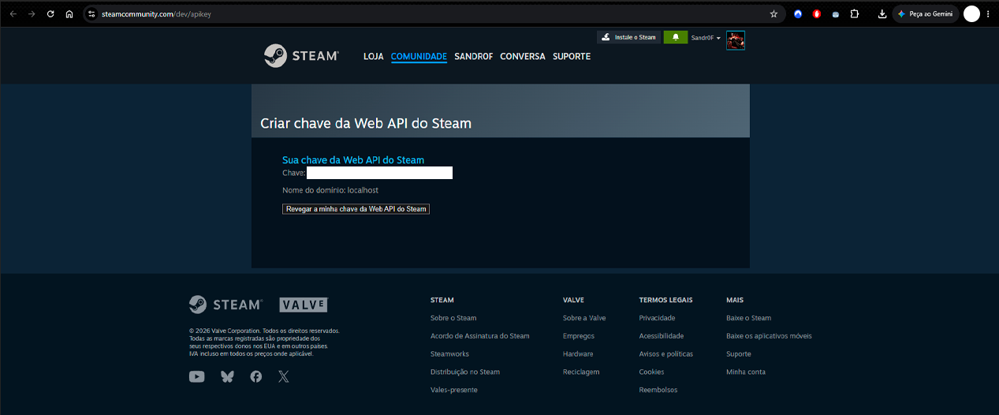
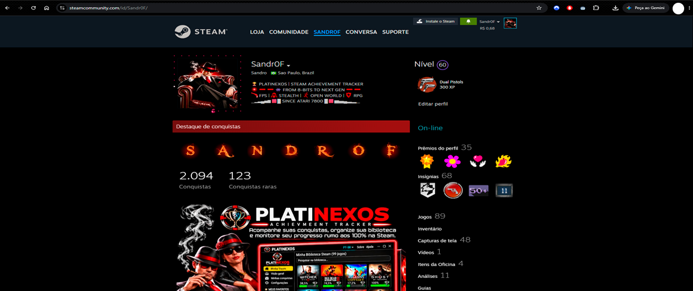
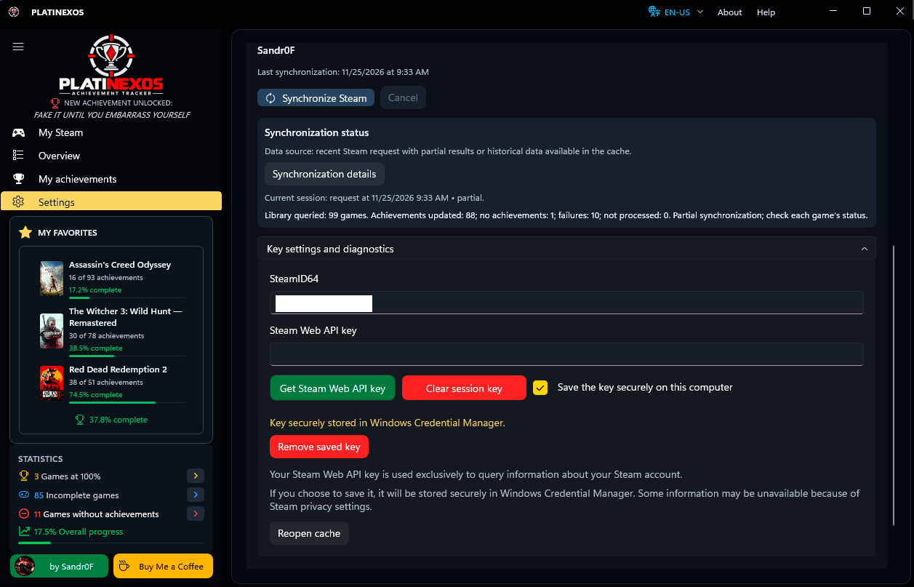

# Steam Web API Key — a three-step guide

**PLATINEXOS 1.0.0 · English (United States)**

[Português brasileiro](GUIA-pt-BR.md) · [Español](GUIA-es-419.md)

PLATINEXOS is a free, independent application with no affiliation, sponsorship or approval from Valve Corporation. To query the Steam Web API, you provide a personal key obtained directly from Valve. The application does not ask for your Steam password or Steam Guard codes and does not unlock achievements.

Valve determines account eligibility and access conditions. This guide does not guarantee that your account can obtain a key. An internet connection is also required for synchronization.

## 1. Obtain your key on Valve’s official page

1. Open [steamcommunity.com/dev/apikey](https://steamcommunity.com/dev/apikey). The **Get Steam Web API key** button in PLATINEXOS opens this page.
2. Check the address and sign in **on the Steam website**, following Valve’s instructions. Passwords and authentication codes belong to Steam’s official sign-in process, never to PLATINEXOS fields.
3. Read the instructions and the [Steam Web API Terms of Use](https://steamcommunity.com/dev/apiterms). If your account is eligible, follow the process Valve presents to obtain your key.
4. If the website requests registration information, provide legitimate information in accordance with the displayed conditions. This guide does not recommend fictitious domains or present `localhost` as an officially approved configuration.
5. Copy the key you obtained for use in the application’s designated field. Treat it as private information: do not publish the page revealing it or send the key in messages, Issues or screenshots.

If Valve does not offer registration or indicates a restriction, follow its official guidance. This guide provides no workaround.



*Official Steam Web API page (Portuguese interface), showing an already-issued key fully concealed. Portuguese interface; an already-issued key is concealed. This is not a registration form or a guarantee of eligibility. The displayed localhost is not an official requirement or recommendation.*

## 2. Identify the Steam profile

1. Open your public Steam profile and copy its URL from the browser’s address bar.
2. In PLATINEXOS, the **SteamID64** field accepts this URL or the corresponding SteamID64 identifier. You do not need a third-party converter to get started.
3. The application resolves a custom profile URL during its Steam query, using a valid key and subject to service availability.

The following are **structure templates** with `< >` placeholders, not addresses or identifiers to paste literally:

```text
https://steamcommunity.com/id/<your-profile-name>/
https://steamcommunity.com/profiles/<your-profile-SteamID64>/
```

In the second form, the segment after `/profiles/` is the SteamID64. Use only your own account or profiles whose owners have requested or authorized the query. Providing a profile does not grant access to private data.



*Steam profile with a custom URL visible in the browser address bar. Authorized public profile; use your own profile or one whose owner authorized the query.*

## 3. Configure and synchronize PLATINEXOS

1. Open **Settings** and **Account and synchronization**.
2. Paste the public profile URL or corresponding identifier into **SteamID64**.
3. Paste your personal key into **Steam Web API key**. It is different from the SteamID64; do not enter your Steam password or a Steam Guard code.
4. Choose whether to enable **Save the key securely on this computer**. This is optional: a saved key uses Windows Credential Manager and is associated with the Windows user profile. Without saving, it remains in memory during the session, as described in the Privacy Policy.
5. Click **Synchronize Steam** and follow its progress. Data availability depends on Steam’s services and the profile’s privacy settings.
6. Once the account is registered, check the selection in **Steam account**. Only if you want to, enable **Sync this Steam account when PLATINEXOS opens**. This authorization is separate from saving the key, is unchecked by default and requires an available saved key. Uncheck it to revoke authorization without deleting the key. Manual synchronization remains available.



*PLATINEXOS Settings (English): Steam account identifier masked and Web API key field empty. English interface; identifier masked and key field empty. Saving the key and authorizing startup synchronization are separate decisions.*

## Protect your key and data

- Do not share your key, password or Steam Guard codes. Review images and reports before sending them.
- If you suspect compromise, revoke the key on [Valve’s official page](https://steamcommunity.com/dev/apikey), obtain another under the service’s conditions and replace the old key in the application. **Remove saved key** in PLATINEXOS removes the local copy; it does not revoke the key at Valve.
- Library data is stored in the Windows profile; saved credentials are kept separately in Windows Credential Manager. See the documents for storage and deletion details.

[Terms of Use](../TERMOS-DE-USO-English.md) · [Privacy Policy](../POLITICA-DE-PRIVACIDADE-English.md)

Support: [GitHub Issues](https://github.com/Sandr0F/PLATINEXOS/issues), without sensitive information. Private contact: [platinexos@gmail.com](mailto:platinexos@gmail.com).
