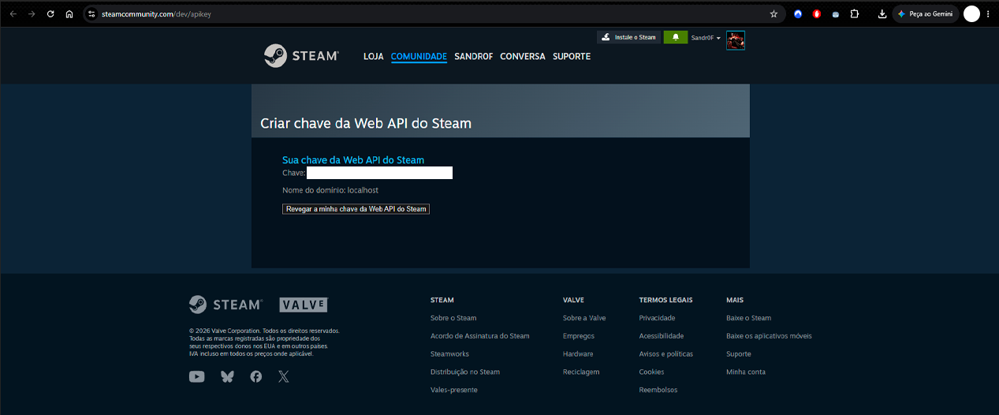
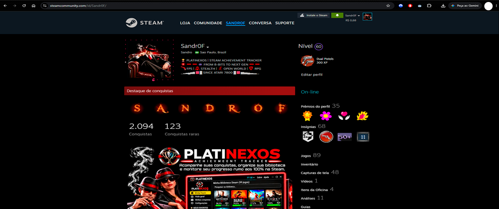
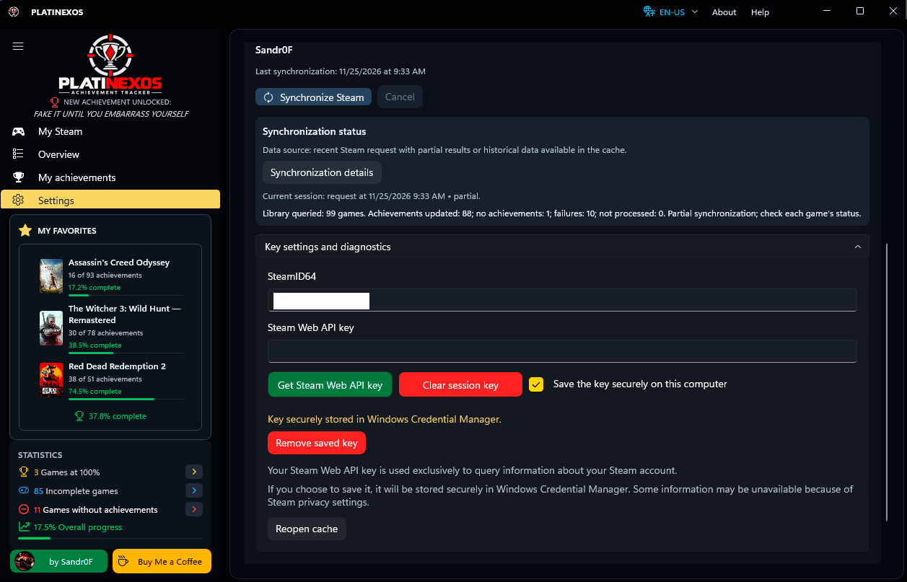

# Steam Web API Key — guía en tres pasos

**PLATINEXOS 1.0.0 · Español latinoamericano**

[Português brasileiro](GUIA-pt-BR.md) · [English](GUIA-en-US.md)

PLATINEXOS es una aplicación gratuita e independiente, sin afiliación, patrocinio ni aprobación de Valve Corporation. Para consultar la Steam Web API, proporcionas una clave personal obtenida directamente de Valve. La aplicación no solicita tu contraseña de Steam ni códigos de Steam Guard y no desbloquea logros.

Valve determina la elegibilidad de las cuentas y las condiciones de acceso. Esta guía no garantiza que tu cuenta pueda obtener una clave. También necesitas conexión a internet para sincronizar.

## 1. Obtener tu clave en la página oficial de Valve

1. Abre [steamcommunity.com/dev/apikey](https://steamcommunity.com/dev/apikey). El botón **Obtener clave Steam Web API** de PLATINEXOS abre esta página.
2. Comprueba la dirección e inicia sesión **en el sitio de Steam**, siguiendo las instrucciones de Valve. La contraseña y los códigos de autenticación pertenecen al proceso oficial de Steam, nunca a los campos de PLATINEXOS.
3. Lee las instrucciones y los [Términos de Uso de la Steam Web API](https://steamcommunity.com/dev/apiterms). Si tu cuenta es elegible, sigue el procedimiento presentado por Valve para obtener tu clave.
4. Si el sitio solicita información de registro, proporciona información legítima de acuerdo con las condiciones mostradas. Esta guía no recomienda dominios ficticios ni presenta `localhost` como una configuración oficialmente aprobada.
5. Copia la clave obtenida para usarla en el campo correspondiente de la aplicación. Trátala como información privada: no publiques la página que la muestra ni envíes la clave en mensajes, Issues o capturas.

Si Valve no permite el registro o indica alguna restricción, sigue sus orientaciones oficiales. Esta guía no ofrece un procedimiento para eludirlas.



*Página oficial de Steam Web API (interfaz en portugués), con una clave ya emitida completamente oculta. Interfaz en portugués; clave ya emitida oculta. No es un formulario de registro ni una garantía de elegibilidad. El localhost visible no es un requisito o recomendación oficial.*

## 2. Identificar el perfil de Steam

1. Abre tu perfil público de Steam y copia la URL de la barra de direcciones del navegador.
2. En PLATINEXOS, el campo **SteamID64** acepta esa URL o el identificador SteamID64 correspondiente. No necesitas un conversor de terceros para comenzar.
3. La aplicación resuelve una URL personalizada durante la consulta a Steam, con una clave válida y según la disponibilidad del servicio.

Los siguientes son **modelos de estructura** con marcadores entre `< >`, no direcciones ni identificadores para pegar literalmente:

```text
https://steamcommunity.com/id/<nombre-de-tu-perfil>/
https://steamcommunity.com/profiles/<SteamID64-de-tu-perfil>/
```

En el segundo formato, el segmento después de `/profiles/` es el SteamID64. Consulta únicamente tu propia cuenta o perfiles cuyos titulares hayan solicitado o autorizado la consulta. Indicar un perfil no concede acceso a datos privados.



*Perfil de Steam con URL personalizada visible en la barra de direcciones. Perfil público autorizado; utilice su perfil o uno cuyo titular autorizó la consulta.*

## 3. Configurar y sincronizar PLATINEXOS

1. Abre **Configuración** y **Cuenta y sincronización**.
2. En **SteamID64**, pega la URL pública del perfil o su identificador correspondiente.
3. En **Clave Steam Web API**, pega tu clave personal. Es diferente del SteamID64; no ingreses tu contraseña de Steam ni un código de Steam Guard.
4. Decide si quieres marcar **Guardar la clave de forma segura en esta computadora**. Es opcional: la clave guardada utiliza el Administrador de Credenciales de Windows, asociada al perfil de Windows. Si no la guardas, permanece en memoria durante la sesión, según la Política de Privacidad.
5. Pulsa **Sincronizar Steam** y observa el progreso. La disponibilidad de los datos depende de los servicios de Steam y de la privacidad del perfil.
6. Después de registrar la cuenta, comprueba la selección en **Cuenta de Steam**. Solo si lo deseas, marca **Sincronizar esta cuenta de Steam al abrir PLATINEXOS**. Esta autorización es independiente de guardar la clave, comienza desmarcada por defecto y requiere una clave guardada disponible. Desmárcala para revocar la autorización sin borrar la clave. La sincronización manual sigue disponible.



*Configuración de PLATINEXOS (inglés): identificador de Steam oculto y campo de clave vacío. Interfaz en inglés; identificador oculto y campo de clave vacío. Guardar la clave y autorizar la sincronización inicial son decisiones separadas.*

## Protege tu clave y tus datos

- No compartas la clave, la contraseña ni códigos de Steam Guard. Revisa las imágenes y los informes antes de enviarlos.
- Si sospechas que la clave está comprometida, revócala en la [página oficial de Valve](https://steamcommunity.com/dev/apikey), obtén otra según las condiciones del servicio y sustituye la anterior en la aplicación. **Eliminar clave guardada** en PLATINEXOS borra la copia local; no revoca la clave en Valve.
- Los datos de la biblioteca se guardan en el perfil de Windows; la credencial guardada se mantiene por separado en el Administrador de Credenciales. Consulta los documentos para los detalles de almacenamiento y eliminación.

[Términos de Uso](../TERMOS-DE-USO-Espanol.md) · [Política de Privacidad](../POLITICA-DE-PRIVACIDADE-Espanol.md)

Soporte: [GitHub Issues](https://github.com/Sandr0F/PLATINEXOS/issues), sin información sensible. Contacto privado: [platinexos@gmail.com](mailto:platinexos@gmail.com).
