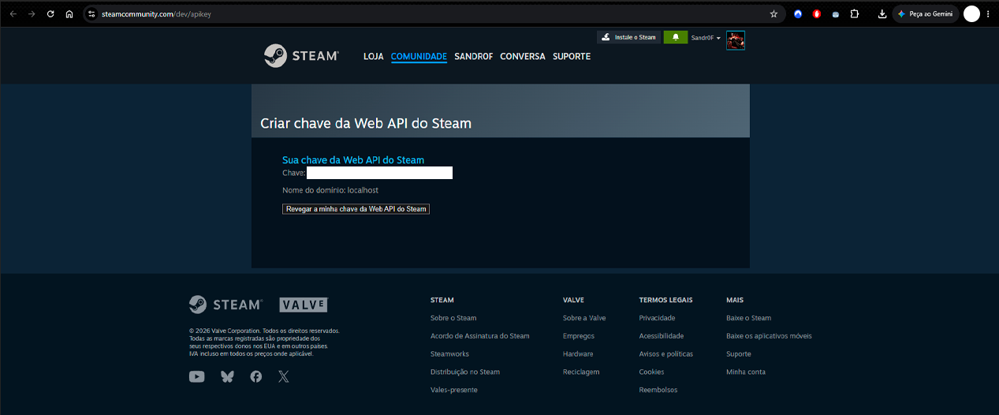
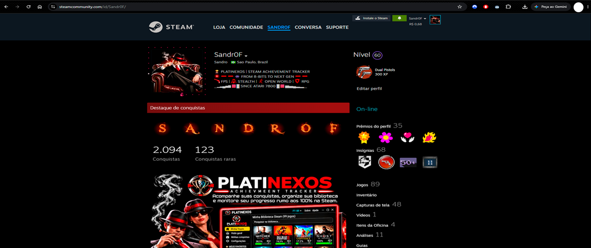
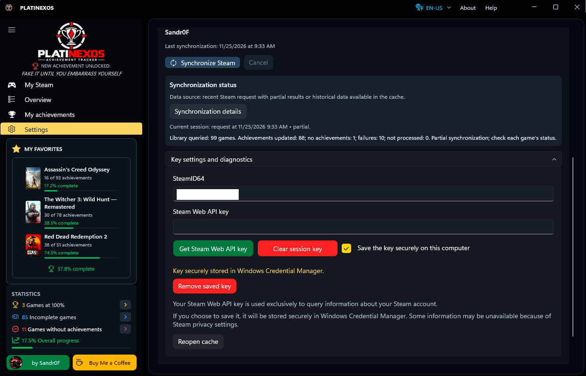

# Steam Web API Key — guia em três etapas

**PLATINEXOS 1.0.0 · Português brasileiro**

[English](GUIA-en-US.md) · [Español](GUIA-es-419.md)

O PLATINEXOS é um aplicativo gratuito e independente, sem afiliação, patrocínio ou aprovação da Valve Corporation. Para consultar dados pela Steam Web API, você informa uma chave pessoal obtida diretamente da Valve. O aplicativo não solicita sua senha Steam nem códigos Steam Guard e não desbloqueia conquistas.

A Valve define a elegibilidade das contas e as condições de acesso. Este guia não garante que sua conta possa obter uma chave. Você também precisa de acesso à internet para sincronizar.

## 1. Obter sua chave na página oficial da Valve

1. Abra [steamcommunity.com/dev/apikey](https://steamcommunity.com/dev/apikey). O botão **Obter chave Steam Web API**, no PLATINEXOS, leva a essa página.
2. Confira o endereço e autentique-se **no site da Steam**, seguindo as instruções da Valve. Senha e códigos de autenticação pertencem ao fluxo oficial da Steam, nunca aos campos do PLATINEXOS.
3. Leia as instruções e os [Termos da Steam Web API](https://steamcommunity.com/dev/apiterms). Se a conta for elegível, siga o procedimento apresentado pela Valve para obter sua chave.
4. Caso o site solicite informações de cadastro, forneça informações legítimas de acordo com as condições apresentadas. Este guia não recomenda domínios fictícios nem apresenta `localhost` como configuração oficialmente aprovada.
5. Copie a chave obtida para utilizá-la no campo próprio do aplicativo. Trate-a como informação privada: não publique a página que a revela nem envie a chave em mensagens, Issues ou capturas.

Se a Valve não disponibilizar o cadastro ou indicar alguma restrição, siga as orientações oficiais. Não há procedimento de contorno indicado neste guia.



*Página oficial da Steam Web API (em português), com chave já emitida completamente ocultada. Interface em português; chave já emitida ocultada. Não é formulário de cadastro nem garantia de elegibilidade. O localhost visível não é exigência ou recomendação oficial.*

## 2. Identificar o perfil Steam

1. Abra seu perfil público na Steam e copie a URL mostrada na barra de endereços do navegador.
2. No PLATINEXOS, o campo **SteamID64** aceita essa URL ou o identificador SteamID64 correspondente. Você não precisa usar um conversor de terceiros para começar.
3. Uma URL personalizada é resolvida pelo aplicativo durante a consulta à Steam, com uma chave válida e conforme a disponibilidade do serviço.

Os formatos abaixo são **modelos de estrutura**, com marcadores entre `< >`, não endereços ou identificadores para colar literalmente:

```text
https://steamcommunity.com/id/<nome-do-seu-perfil>/
https://steamcommunity.com/profiles/<SteamID64-do-seu-perfil>/
```

Na segunda forma, o segmento depois de `/profiles/` é o SteamID64. Use somente sua própria conta ou perfis cujos titulares tenham solicitado ou autorizado a consulta. Informar um perfil não concede acesso a dados privados.



*Perfil Steam com URL personalizada visível na barra de endereços. Perfil público autorizado; utilize seu perfil ou um perfil cujo titular autorizou a consulta.*

## 3. Configurar e sincronizar no PLATINEXOS

1. Abra **Configurações** e a seção **Conta e sincronização**.
2. No campo **SteamID64**, cole a URL pública do perfil ou seu identificador correspondente.
3. No campo **Chave Steam Web API**, cole sua chave pessoal. Ela é diferente do SteamID64; não informe senha Steam ou código Steam Guard.
4. Escolha se deseja marcar **Salvar chave com segurança neste computador**. Essa escolha é opcional: quando salva, a chave utiliza o Gerenciador de Credenciais do Windows, vinculada ao perfil Windows. Sem salvamento, ela permanece em memória durante a sessão, conforme a Política de Privacidade.
5. Clique em **Sincronizar Steam** e acompanhe o andamento. A disponibilidade dos dados depende dos serviços da Steam e da privacidade do perfil.
6. Depois de cadastrar a conta, confira a seleção em **Conta Steam**. Somente se desejar, marque **Sincronizar esta conta Steam ao abrir o PLATINEXOS**. Essa autorização é separada do salvamento da chave, começa desmarcada por padrão e requer uma chave salva disponível. Desmarque-a para revogar a autorização sem apagar a chave. A sincronização manual continua disponível.



*Configurações do PLATINEXOS (inglês): identificador Steam ocultado e campo da chave vazio. Interface em inglês; identificador ocultado e campo da chave vazio. Salvar a chave e autorizar a sincronização inicial são decisões separadas.*

## Proteja sua chave e seus dados

- Não compartilhe chave, senha ou códigos Steam Guard. Revise imagens e relatórios antes de enviá-los.
- Se suspeitar de comprometimento, revogue a chave na [página oficial da Valve](https://steamcommunity.com/dev/apikey), obtenha outra conforme as condições do serviço e substitua a antiga no aplicativo. **Remover chave salva** no PLATINEXOS remove a cópia local; não revoga a chave na Valve.
- Os dados da biblioteca ficam no perfil Windows; a credencial salva fica separada no cofre do Windows. Consulte os documentos para os detalhes de armazenamento e exclusão.

[Termos de Uso](../TERMOS-DE-USO.md) · [Política de Privacidade](../POLITICA-DE-PRIVACIDADE.md)

Suporte: [GitHub Issues](https://github.com/Sandr0F/PLATINEXOS/issues), sem informações sensíveis. Contato privado: [platinexos@gmail.com](mailto:platinexos@gmail.com).
