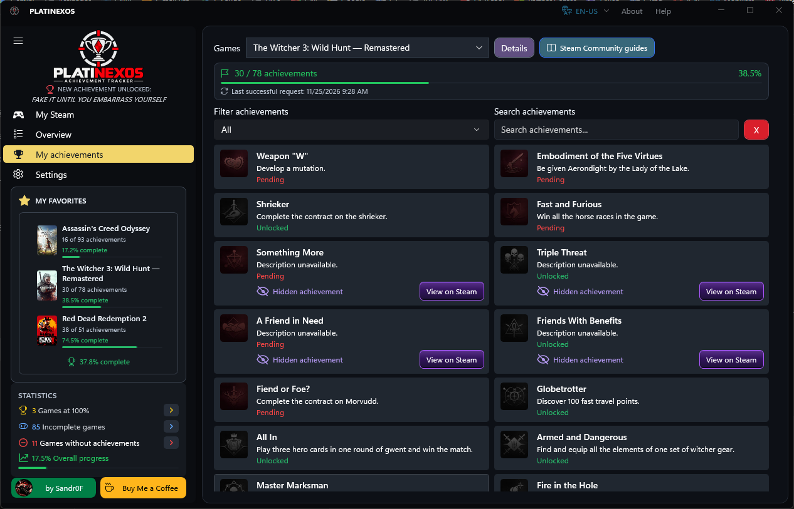
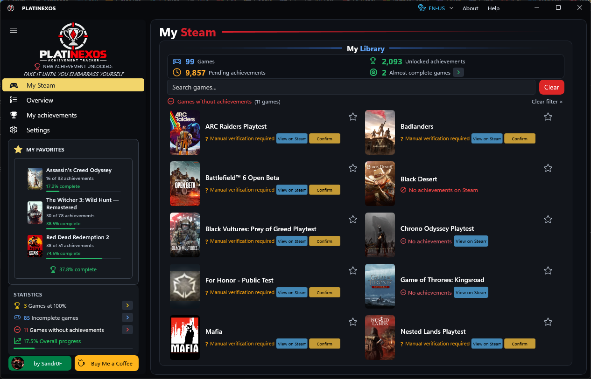
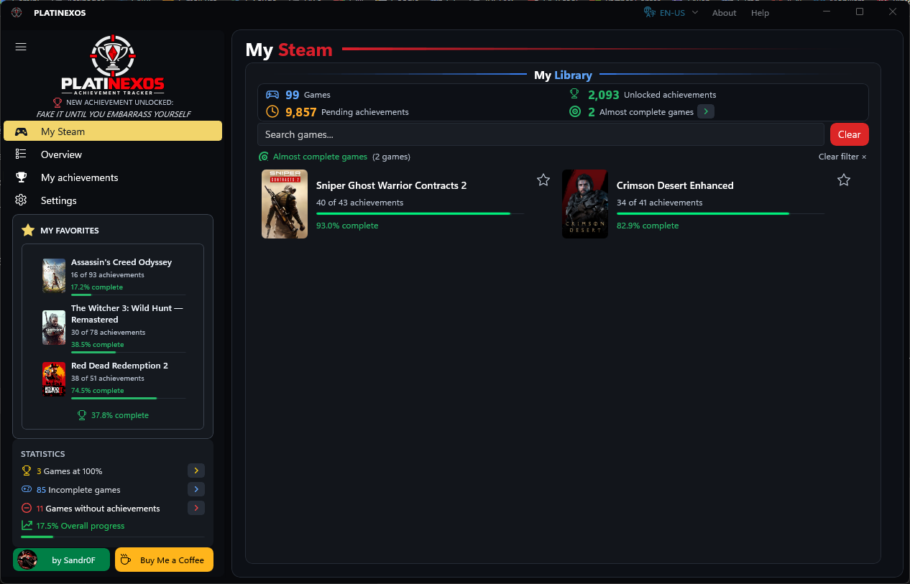
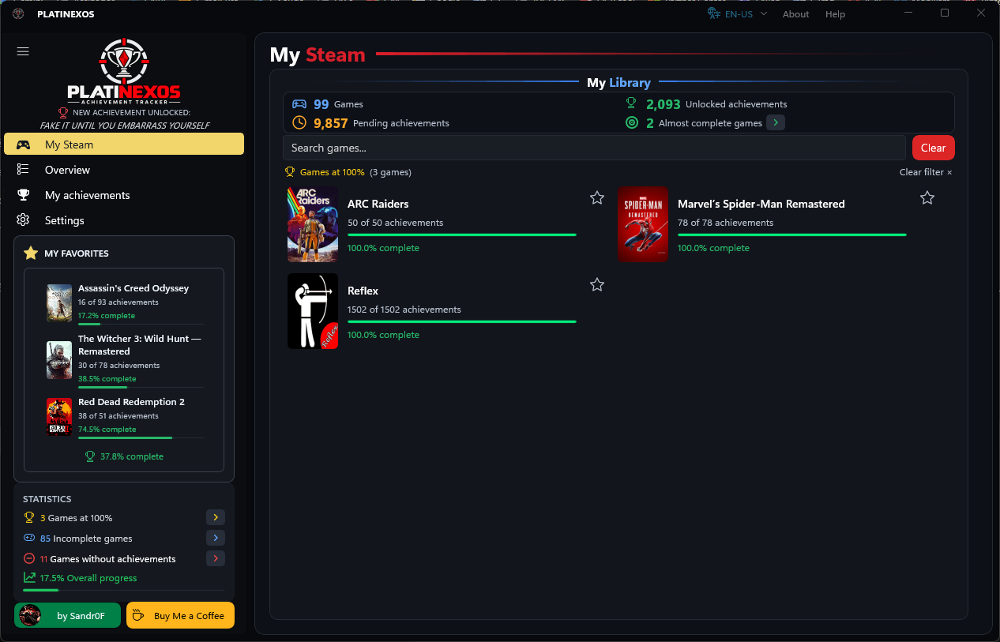

# Capturas reales de la aplicación

[English](README.md) | [Português (Brasil)](README-pt-BR.md) | [Español (Latinoamérica)](README-Espanol.md)

Capturas originales con interfaz en inglés; leyendas en español abajo.

*Resumen de la biblioteca de Steam y estadísticas de progreso*

*Logros individuales y seguimiento del progreso*

*Juegos sin logros y elementos pendientes de verificación manual*

*Juegos próximos al 100 % de finalización*

*Juegos completados al 100 %*

