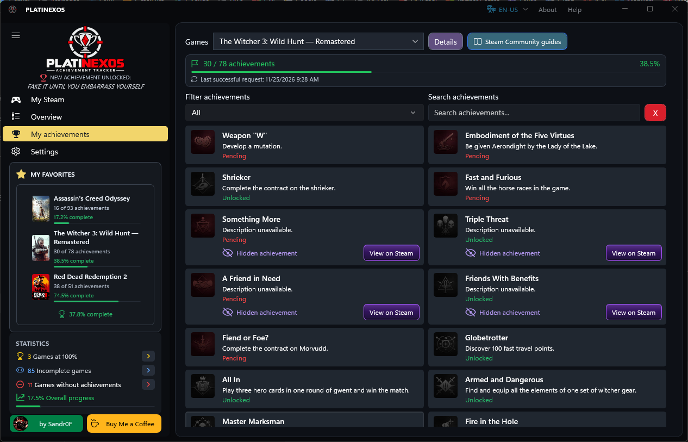
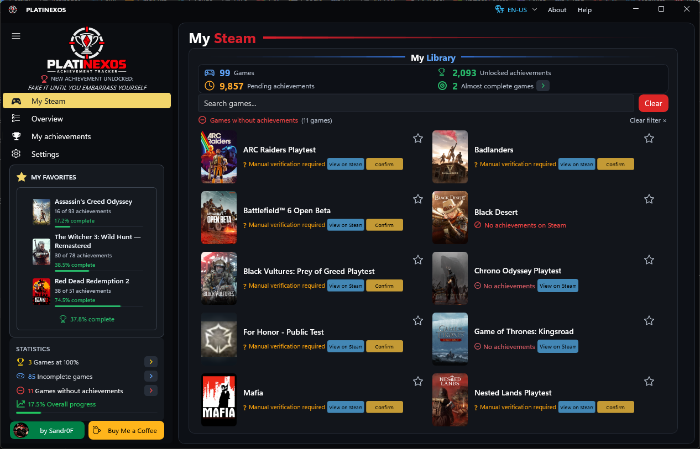
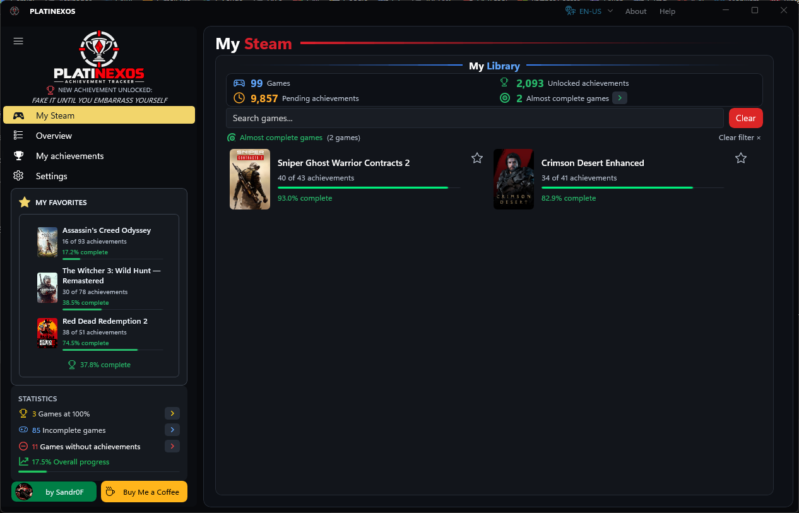
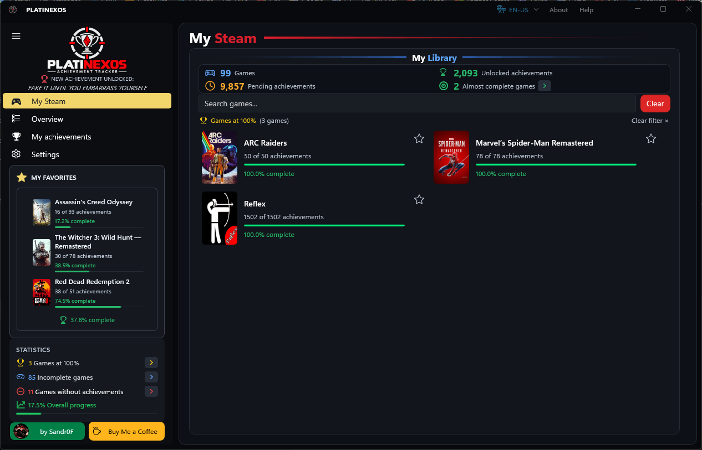

# Capturas reais do aplicativo

[English](README.md) | [Português (Brasil)](README-pt-BR.md) | [Español (Latinoamérica)](README-Espanol.md)

Capturas originais com interface em inglês; legendas em português abaixo.

*Visão geral da biblioteca Steam e estatísticas de progresso*

*Conquistas individuais e acompanhamento de progresso*

*Jogos sem conquistas e itens pendentes de verificação manual*

*Jogos próximos de 100% de conclusão*

*Jogos concluídos em 100%*

