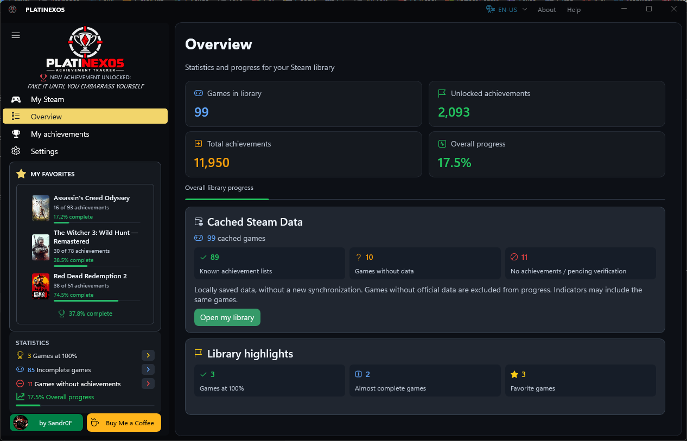

# PLATINEXOS

[English](README.md) | [Português (Brasil)](README-pt-BR.md) | [Español (Latinoamérica)](README-Espanol.md)

[Notas da Release](Release/RELEASE-pt-BR.md) · [Segurança](RELATORIO-DE-SEGURANCA-pt-BR.md) · [Steam Web API Key](Guia-Steam-Web-API-Key/GUIA-pt-BR.md) · [Capturas reais do aplicativo](IMAGENS-pt-BR.md)


O **PLATINEXOS** é um aplicativo gratuito e independente para **Windows 11 x64**. Acompanhe sua biblioteca Steam e o progresso nas conquistas, consulte indicadores e estatísticas e organize favoritos e objetivos pessoais. A interface está disponível em português brasileiro, inglês americano e espanhol latino-americano.

O aplicativo não desbloqueia conquistas na Steam, não modifica jogos e não altera arquivos de salvamento. Não há afiliação, patrocínio ou aprovação da Valve Corporation. Steam é marca da Valve Corporation.

O PLATINEXOS é disponibilizado sob uma licença gratuita de uso pessoal e não comercial, com código-fonte próprio fechado, conforme os [Termos de Uso](TERMOS-DE-USO.md). Os componentes de terceiros mantêm suas próprias licenças.

## Download oficial e requisitos

Baixe o Portable em ZIP nas [Releases oficiais do PLATINEXOS](https://github.com/Sandr0F/PLATINEXOS/releases).

- Windows 11 x64.
- Internet para sincronização e obtenção de conteúdo remoto; dados já carregados podem ser consultados localmente conforme as limitações do aplicativo.
- SteamID64 ou URL de perfil e uma chave Steam Web API válida para configurar a sincronização.

O pacote inclui .NET e Windows App SDK pelo processo self-contained. Não é necessário manter o cliente Steam aberto para consultar a Web API. A execução sem o cliente Steam instalado foi verificada anteriormente em um ambiente Windows 10; a versão 1.0.0 foi validada em Windows 11 x64. A detecção opcional de jogos instalados depende dos arquivos locais da Steam. Esses resultados não garantem funcionamento em todas as instalações do Windows nem eliminam eventuais requisitos de componentes nativos. Não foram definidos requisitos mínimos de CPU, memória ou espaço livre sem medição.

## Extrair, verificar e executar

1. Consulte os [Termos de Uso](TERMOS-DE-USO.md), a [Política de Privacidade](POLITICA-DE-PRIVACIDADE.md) e as [licenças de terceiros](LICENCAS-DE-TERCEIROS.md).
2. Baixe o ZIP e o arquivo `.sha256` da mesma Release oficial.
3. No PowerShell, na pasta do download, execute o comando abaixo, substituindo o nome pelo arquivo baixado, e compare o resultado com o `.sha256`:

   ```powershell
   Get-FileHash -Algorithm SHA256 -LiteralPath '.\nome-do-arquivo.zip'
   ```

4. Extraia **todo o conteúdo** para uma pasta do seu usuário. Não execute dentro do ZIP nem copie somente o EXE.
5. Abra `Platinexos.exe` sem privilégios de administrador, consulte os documentos e decida se aceita os termos apresentados.

O executável 1.0.0 está sem assinatura digital. O Windows poderá apresentar avisos: confira a procedência do arquivo e não desative as proteções do sistema. O SHA-256 confere integridade, mas não comprova a identidade do editor.

## Configurar a Steam Web API

Em **Configurações**, informe o SteamID64 ou a URL do perfil e a chave pessoal válida da Steam Web API. Obtenha a chave legitimamente na sua própria conta pela [página oficial da Valve](https://steamcommunity.com/dev/apikey). Consulte suas próprias contas ou perfis de terceiros cujos titulares tenham solicitado ou autorizado a consulta. O aplicativo não concede acesso a informações privadas.

- Informe a chave somente no campo próprio do PLATINEXOS. O aplicativo não solicita senha Steam nem códigos Steam Guard.
- O salvamento no **Gerenciador de Credenciais do Windows** é opcional. A chave não fica no SQLite, cache ou preferências.
- **Salvar a chave não autoriza a sincronização automática.** Para sincronizar ao abrir, ative a autorização específica para a conta Steam desejada. A opção começa desmarcada, inclusive para contas que já tenham chave salva, e requer uma chave salva disponível.
- Você pode revogar essa autorização em Configurações sem apagar a chave. A sincronização manual continua disponível.
- Não compartilhe chaves em Issues, relatórios ou capturas. Se houver comprometimento, revogue a chave no serviço oficial da Valve, cadastre outra e substitua a antiga no aplicativo. Removê-la do aplicativo não a revoga na Valve.

A chave deve ser obtida pelo próprio usuário diretamente da Valve, mediante aceitação dos termos do serviço. O usuário é responsável pelo cadastro, pelo domínio associado quando solicitado, pelo uso e pelo sigilo da chave. O PLATINEXOS não possui aprovação oficial conhecida da Valve; o uso de `localhost` não comprova tal aprovação. O acesso à Steam Web API poderá ser alterado, restringido, suspenso ou encerrado pela Valve conforme seus termos.

Os dados são armazenados por perfil Windows. Extrair o Portable em outra pasta não cria um perfil de dados isolado. Consulte a Política para entender o armazenamento, os serviços externos e a remoção separada de dados e credenciais.

## Atualizações da modalidade Portable

As atualizações são baixadas manualmente pelos canais oficiais. Não há instalação automática de atualizações nesta modalidade.

## Documentos por idioma

| Idioma | Termos de Uso | Política de Privacidade |
|---|---|---|
| Português brasileiro | [Termos de Uso](TERMOS-DE-USO.md) | [Política de Privacidade](POLITICA-DE-PRIVACIDADE.md) |
| English (United States) | [Terms of Use](TERMOS-DE-USO-English.md) | [Privacy Policy](POLITICA-DE-PRIVACIDADE-English.md) |
| Español latinoamericano | [Términos de Uso](TERMOS-DE-USO-Espanol.md) | [Política de Privacidad](POLITICA-DE-PRIVACIDADE-Espanol.md) |

- [Avisos de Direitos Autorais](AVISOS-DE-DIREITOS-AUTORAIS.md).
- [Índice de licenças de terceiros](LICENCAS-DE-TERCEIROS.md).
- [Relação dos arquivos originais de licença](LICENSE-FILES.txt).

Os Termos, as Políticas, o índice e os textos originais de licenças deste repositório são cópias integrais dos documentos que acompanham o Portable aprovado. Os arquivos HTML e RTF das licenças são preservados em seus formatos originais e podem ser baixados para leitura. Caminhos `Legal/...` mencionados nos textos referem-se à organização dentro do ZIP; nesta página, os documentos e a pasta `Licencas/` ficam na raiz do repositório documental.

## Suporte e contato

Use o [GitHub Issues do PLATINEXOS](https://github.com/Sandr0F/PLATINEXOS/issues) para relatar problemas e sugerir melhorias. O canal é público: não publique senhas, chaves Steam, bancos pessoais, caches ou outras informações sensíveis.

Para comunicações privadas ou relacionadas à privacidade: [platinexos@gmail.com](mailto:platinexos@gmail.com).

Eventuais contribuições financeiras são inteiramente voluntárias e destinadas ao desenvolvimento independente. Nenhuma funcionalidade depende de pagamento.

## Segurança e confiabilidade

O pacote PLATINEXOS 1.0.0 registrou **0/60 detecções antivírus no VirusTotal** na reanálise de 25/11/2026, classificação **Clean (Limpo) no Kaspersky OpenTIP** e **0/21 detecções antivírus no OPSWAT MetaDefender**, com resultado geral **No Threats Detected**.

[Consultar análise no VirusTotal](https://www.virustotal.com/gui/file/eb3a4f50d6a796b35ef0678bbebbdb01c3bacc683ffaf57ab7a10bd4d122cecf/detection). Link direto confirmado pelo desenvolvedor em janela anônima. Não é necessário novo envio. Nomes de candidatos anteriores correspondem ao mesmo SHA-256.

```text
EB3A4F50D6A796B35EF0678BBEBBDB01C3BACC683FFAF57AB7A10BD4D122CECF
```

Estas são verificações selecionadas. O [Relatório detalhado de segurança](RELATORIO-DE-SEGURANCA-pt-BR.md) distingue os resultados antivírus dos indicadores comportamentais, registra o alerta Sigma investigado e os módulos adicionais do MetaDefender que não concluíram suas verificações. O SHA-256 e os arquivos oficiais estão nas [Releases do PLATINEXOS](https://github.com/Sandr0F/PLATINEXOS/releases).


## Capturas reais do aplicativo



[Capturas reais do aplicativo](IMAGENS-pt-BR.md).

[Leitura dos documentos jurídicos e licenças originais](DOCUMENTOS-E-LICENCAS-pt-BR.md).
