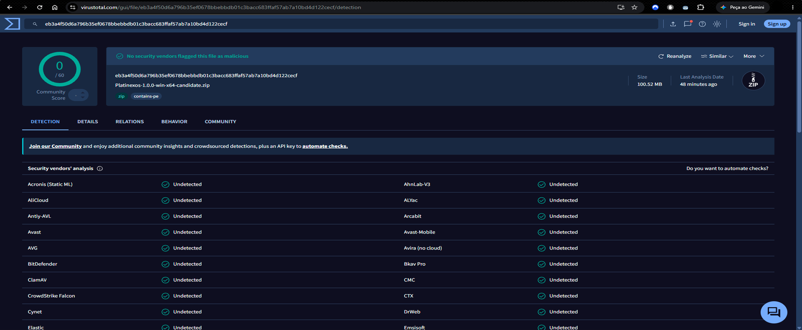
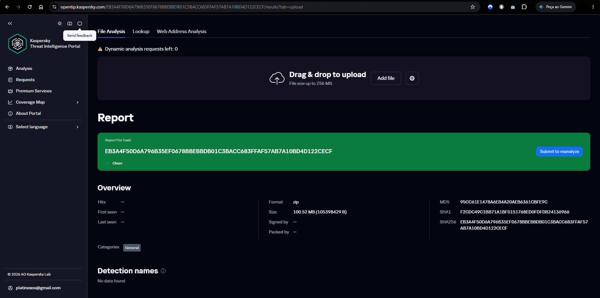
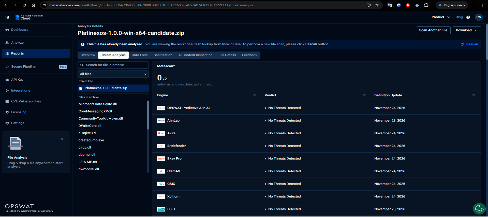

# Selected security checks — PLATINEXOS 1.0.0

[English](README.md) | [Português (Brasil)](README-pt-BR.md) | [Español (Latinoamérica)](README-Espanol.md)


Consolidation date: November 25, 2026.

This document presents three services selected for the public communication of PLATINEXOS 1.0.0. **It is not a complete history of every test, examination, or audit performed.** Earlier technical records remain preserved separately; this revision neither changes nor replaces them.

## File covered by these results

- Official name: **PLATINEXOS-1.0.0-win-x64-Portable.zip**.
- Size: **105,398,429 bytes**.
- Contents: **575 files**.
- SHA-256:

```text
EB3A4F50D6A796B35EF0678BBEBBDB01C3BACC683FFAF57AB7A10BD4D122CECF
```

Some reports display the candidate's earlier filename. The SHA-256 matches the official file: renaming did not change its contents. The hash verifies content identity and integrity but does not replace a publisher's digital signature. The 1.0.0 executable is not digitally signed.

## Selected results

| Service | Documented result | Scope |
|---|---|---|
| VirusTotal | **0/60 antivirus detections**, rescanned on November 25, 2026 | [View VirusTotal analysis](https://www.virustotal.com/gui/file/eb3a4f50d6a796b35ef0678bbebbdb01c3bacc683ffaf57ab7a10bd4d122cecf/detection) |
| Kaspersky OpenTIP | **Clean** for the final ZIP | Classification shown on the file's dashboard; not presented as confirmation of a completed full dynamic analysis |
| OPSWAT MetaDefender Cloud | **0/21 antivirus detections** and overall result **No Threats Detected** | Available results; some additional modules did not complete their checks |

The external results in this revision are the records and confirmations provided by the developer. No new analyses were requested, tests rerun, or previously validated lookup procedures rechecked. The technical observations below reuse investigations already completed on the same ZIP.

## VirusTotal — antivirus result and Sigma indicator

The selected antivirus result is **0/60**, from the November 25, 2026 rescan. This number describes the antivirus panel, not every behavioral indicator. The behavioral signature **Potential Vcruntime140 DLL Sideloading**, severity HIGH, was recorded in both analyses reported by the developer.

The targeted package investigation found:

- No copy of `vcruntime140.dll` or its variants in the ZIP.
- No Python components or `.pyd` files in the distributed package.
- No `.dmp` files in the ZIP.
- A legitimate `createdump.exe` from the .NET 10.0.13 runtime, identical to the NuGet source and bearing a valid Microsoft signature.
- No application-owned mechanism for improper DLL loading identified in the code examined.
- No demonstrated defect warranting a rebuild of the application.

Static inspection of the normal and delay-load imports of nine native components found references to the Windows Universal C Runtime (`api-ms-win-crt-*`), with no `vcruntime140` references in those tables. This does not establish every transitive load that might occur in the analyzed environment's operating system.

**The exact origin of the Sigma signature remained inconclusive.** During the investigation, access to detailed behavioral data was blocked by HTTP 429/RecaptchaRequiredError. It was not possible to identify the process that triggered the rule, the path/hash of the observed DLL, the process responsible for the dump, or the origin of the Python components mentioned in the environment. The access protection was not bypassed.

The DLL's absence from the distributed contents rules out the specific hypothesis of a substituted copy shipped inside the ZIP, but does not, by itself, explain the sandbox event. The signature is not labeled a proven false positive. Its HIGH severity and the 0/60 antivirus result are distinct pieces of information, both retained in this document.

Technical reference for the corresponding public rule: [SigmaHQ — Potential Vcruntime140 DLL Sideloading](https://github.com/SigmaHQ/sigma/blob/master/rules/windows/image_load/image_load_side_load_vcruntime140.yml). The exact revision used by VirusTotal was not confirmed.

### How to consult the VirusTotal report

[View VirusTotal analysis](https://www.virustotal.com/gui/file/eb3a4f50d6a796b35ef0678bbebbdb01c3bacc683ffaf57ab7a10bd4d122cecf/detection). Direct report link confirmed by the developer in an incognito window. No new upload is needed. Earlier candidate names refer to the same SHA-256.

## Kaspersky OpenTIP

The final ZIP was classified as **Clean**. The screenshot described by the developer identifies the file, its SHA-256, size of 105,398,429 bytes, and ZIP format.

[View the ZIP report on Kaspersky OpenTIP](https://opentip.kaspersky.com/EB3A4F50D6A796B35EF0678BBEBBDB01C3BACC683FFAF57AB7A10BD4D122CECF/results?tab=upload).

This presentation concerns the ZIP. It does not treat the dashboard as evidence that a complete dynamic analysis finished when the specific documented result does not demonstrate that.

## OPSWAT MetaDefender Cloud

The supplied records show:

- Overall result: **No Threats Detected**.
- MetaScan: **Not Detected**.
- Threat Analysis: **0/21**.
- File Details: **Allowed**.
- Reason: **No Threat Detected**.

[View the ZIP report on MetaDefender Cloud](https://metadefender.com/results/hash/EB3A4F50D6A796B35EF0678BBEBBDB01C3BACC683FFAF57AB7A10BD4D122CECF/overview).

The developer confirmed that the address works in an incognito window. Some additional modules did not complete their checks. Accordingly, the document does not claim completion of every module, and antivirus results are not confused with DLP indicators.

### Investigated DLP findings

`MANIFESTO.json`, `DEPENDENCIAS.json`, and `AVISOS-LEGAIS.txt` were examined in full. No private credentials or private personal information were found in these three files.

| File | Evidence and limits of the investigation |
|---|---|
| MANIFESTO.json | Eight reported positions were located: five in SHA-256 hashes and three in component-path versions. All eight are confirmed false positives based on the context and origin of the values. All 574 hashes match the actual files. Eight other findings lacked sufficient location information for individual matching. |
| DEPENDENCIAS.json | The 22 entries contain a name, version, and public NuGet URL. Fourteen nine-digit sequences were identified in public versions and URLs; without provider offsets, individual attribution to the 14 alerts remains inconclusive. |
| AVISOS-LEGAIS.txt | Three nine-digit sequences correspond to component versions or a public URL. Individually matching them to the three alerts requires their original locations. |

The 25 findings without individually confirmed matches were not treated as 25 instances of private data. The investigation found no need to remove hashes, edit version numbers, or rebuild the ZIP to address these flags.

## Safe use of Steam integration

PLATINEXOS is free and independent, without affiliation, sponsorship, or approval by Valve Corporation. It does not request Steam passwords or Steam Guard codes. Integration uses a personal Steam Web API key, with optional storage in Windows Credential Manager. Saving the key and authorizing automatic synchronization are separate decisions for each account.

Do not share your key in Issues, screenshots, or reports. Consult the [Terms of Use](TERMOS-DE-USO.md) and [Privacy Policy](POLITICA-DE-PRIVACIDADE.md) for the applicable terms and instructions on storage, revocation, and deletion. This explanatory document does not modify those legal texts.

## Conclusion and documented limitations

The reported results are **0/60 in the VirusTotal antivirus panel**, **Clean in Kaspersky OpenTIP**, and **0/21 with No Threats Detected in MetaDefender**. The technical inspections did not demonstrate malicious behavior or a defect warranting changes to the approved PLATINEXOS 1.0.0.

The documented limitations remain: additional MetaDefender modules that did not complete, incomplete individual attribution of some DLP flags, and the undetermined origin of the Sigma signature. These limitations are not turned into unproven defects, nor is the antivirus count presented as absolute certification of the file or each component. Neither the application nor its package was modified to influence the results.


## Screenshots of the selected results



*VirusTotal: 0 of 60 antivirus engines detected a threat*



*Kaspersky OpenTIP: Clean*



*OPSWAT MetaDefender: 0 of 21 antivirus engines detected a threat*

Additional original evidence (including a historical earlier detection screen):

- [01-virustotal-file-details.png](Imagens-Release-v3/02-Security-Reports/Additional/01-virustotal-file-details.png)
- [02-metadefender-overview.png](Imagens-Release-v3/02-Security-Reports/Additional/02-metadefender-overview.png)
- [03-metadefender-file-details.png](Imagens-Release-v3/02-Security-Reports/Additional/03-metadefender-file-details.png)
- [04-virustotal-detection-previous.png](Imagens-Release-v3/02-Security-Reports/Additional/04-virustotal-detection-previous.png)
