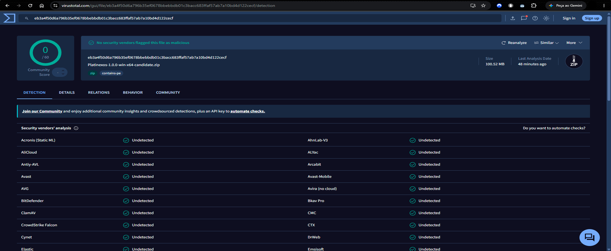
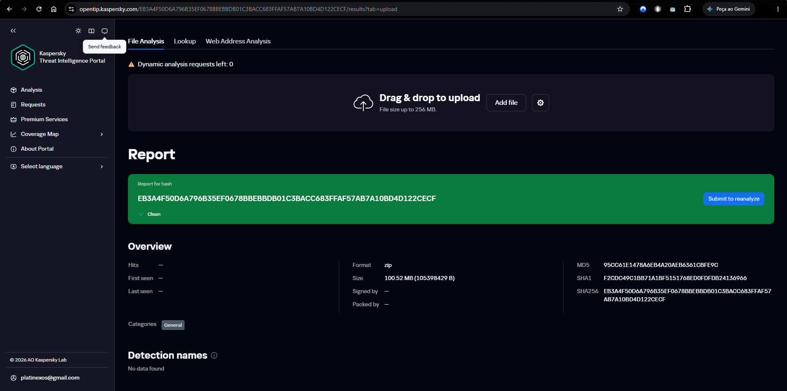
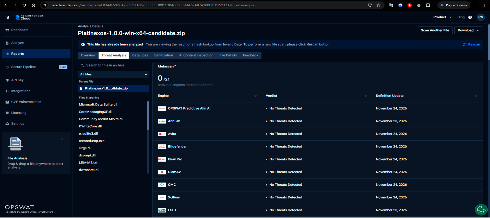

# Verificaciones de seguridad seleccionadas — PLATINEXOS 1.0.0

[English](README.md) | [Português (Brasil)](README-pt-BR.md) | [Español (Latinoamérica)](README-Espanol.md)


Fecha de consolidación: 25 de noviembre de 2026.

Este documento presenta tres servicios seleccionados para la comunicación pública de PLATINEXOS 1.0.0. **No constituye un historial completo de todas las pruebas, evaluaciones o auditorías realizadas.** Los registros técnicos anteriores se conservan por separado; esta revisión no los modifica ni los sustituye.

## Archivo al que corresponden los resultados

- Nombre oficial: **PLATINEXOS-1.0.0-win-x64-Portable.zip**.
- Tamaño: **105.398.429 bytes**.
- Contenido: **575 archivos**.
- SHA-256:

```text
EB3A4F50D6A796B35EF0678BBEBBDB01C3BACC683FFAF57AB7A10BD4D122CECF
```

Algunos informes muestran el nombre anterior del paquete candidato. El SHA-256 corresponde al archivo oficial: cambiar el nombre no modificó su contenido. El hash permite verificar la identidad y la integridad del contenido, pero no sustituye la firma digital del editor. El ejecutable 1.0.0 no tiene firma digital.

## Resultados seleccionados

| Servicio | Resultado documentado | Alcance |
|---|---|---|
| VirusTotal | **0/60 detecciones antivirus**, nuevo análisis del 25/11/2026 | [Consultar análisis en VirusTotal](https://www.virustotal.com/gui/file/eb3a4f50d6a796b35ef0678bbebbdb01c3bacc683ffaf57ab7a10bd4d122cecf/detection) |
| Kaspersky OpenTIP | **Clean (Limpio)** para el ZIP definitivo | Clasificación mostrada en el panel del archivo; no se presenta como confirmación de un análisis dinámico completo |
| OPSWAT MetaDefender Cloud | **0/21 detecciones antivirus** y resultado general **No Threats Detected** | Resultados disponibles; algunos módulos adicionales no completaron sus verificaciones |

Los resultados externos de esta revisión proceden de los registros y confirmaciones proporcionados por el desarrollador. No se solicitaron nuevos análisis, no se repitieron pruebas ni se volvieron a verificar procedimientos de consulta ya validados. Las observaciones técnicas siguientes aprovechan las investigaciones ya concluidas sobre el mismo ZIP.

## VirusTotal — resultado antivirus e indicador Sigma

El resultado antivirus seleccionado es **0/60**, correspondiente al nuevo análisis del 25/11/2026. Este número describe el panel antivirus, no todos los indicadores de comportamiento. La firma de comportamiento **Potential Vcruntime140 DLL Sideloading**, de nivel HIGH, apareció en ambos análisis informados por el desarrollador.

La investigación específica del paquete encontró:

- Ninguna copia de `vcruntime140.dll` ni sus variantes dentro del ZIP.
- Ningún componente Python ni archivo `.pyd` en el paquete distribuido.
- Ningún archivo `.dmp` en el ZIP.
- Un `createdump.exe` legítimo del entorno de ejecución .NET 10.0.13, idéntico al archivo de origen de NuGet y con firma válida de Microsoft.
- Ningún mecanismo propio de carga indebida de DLL identificado en el código examinado.
- Ningún defecto demostrado que justificara volver a compilar el aplicativo.

La inspección estática de las importaciones normales y diferidas de nueve componentes nativos encontró referencias al Universal C Runtime de Windows (`api-ms-win-crt-*`), sin referencias a `vcruntime140` en esas tablas. Esto no demuestra todas las cargas transitivas que podrían ocurrir en el sistema operativo del entorno analizado.

**El origen exacto de la firma Sigma sigue sin determinarse.** Durante la investigación, el acceso a los datos detallados de comportamiento quedó bloqueado por HTTP 429/RecaptchaRequiredError. No fue posible identificar el proceso que activó la regla, la ruta/hash de la DLL observada, el proceso responsable del volcado de memoria ni el origen de los componentes Python mencionados en el entorno. No se eludió la protección de acceso.

La ausencia de la DLL en el contenido distribuido descarta la hipótesis específica de una copia sustituida incluida en el ZIP, pero no explica por sí sola el evento del sandbox. La firma no se clasifica como falso positivo demostrado. Su nivel HIGH y el resultado antivirus 0/60 son datos distintos que se conservan en este documento.

Referencia técnica de la regla pública correspondiente: [SigmaHQ — Potential Vcruntime140 DLL Sideloading](https://github.com/SigmaHQ/sigma/blob/master/rules/windows/image_load/image_load_side_load_vcruntime140.yml). No se confirmó la revisión exacta utilizada por VirusTotal.

### Cómo consultar el informe de VirusTotal

[Consultar análisis en VirusTotal](https://www.virustotal.com/gui/file/eb3a4f50d6a796b35ef0678bbebbdb01c3bacc683ffaf57ab7a10bd4d122cecf/detection). Enlace directo confirmado por el desarrollador en una ventana privada. No es necesario volver a subir el archivo. Los nombres de candidatos anteriores corresponden al mismo SHA-256.

## Kaspersky OpenTIP

El ZIP definitivo recibió la clasificación **Clean**. La captura descrita por el desarrollador identifica el archivo, su SHA-256, su tamaño de 105.398.429 bytes y su formato ZIP.

[Consultar el informe del ZIP en Kaspersky OpenTIP](https://opentip.kaspersky.com/EB3A4F50D6A796B35EF0678BBEBBDB01C3BACC683FFAF57AB7A10BD4D122CECF/results?tab=upload).

Esta presentación se refiere al ZIP. No se interpreta el panel como prueba de que se haya completado un análisis dinámico integral cuando el resultado específico documentado no lo demuestra.

## OPSWAT MetaDefender Cloud

Los registros proporcionados muestran:

- Resultado general: **No Threats Detected**.
- MetaScan: **Not Detected**.
- Threat Analysis: **0/21**.
- File Details: **Allowed**.
- Reason: **No Threat Detected**.

[Consultar el informe del ZIP en MetaDefender Cloud](https://metadefender.com/results/hash/EB3A4F50D6A796B35EF0678BBEBBDB01C3BACC683FFAF57AB7A10BD4D122CECF/overview).

El desarrollador confirmó que la dirección funciona en una ventana de incógnito. Algunos módulos adicionales no completaron sus verificaciones. Por ello, no se afirma que todos los módulos hayan finalizado ni se confunden los resultados antivirus con los indicadores DLP.

### Señalamientos DLP investigados

Se examinaron por completo `MANIFESTO.json`, `DEPENDENCIAS.json` y `AVISOS-LEGAIS.txt`. No se encontraron credenciales privadas ni datos personales privados en esos tres archivos.

| Archivo | Evidencia y límites de la investigación |
|---|---|
| MANIFESTO.json | Se localizaron ocho posiciones indicadas: cinco en hashes SHA-256 y tres en versiones de rutas de componentes. Los ocho casos son falsos positivos confirmados por el contexto y el origen de los valores. Los 574 hashes coinciden con los archivos reales. Otros ocho señalamientos carecían de información de ubicación suficiente para establecer una correspondencia individual. |
| DEPENDENCIAS.json | Los 22 registros contienen nombre, versión y URL pública de NuGet. Se identificaron 14 secuencias de nueve dígitos en versiones y URL públicas; sin las posiciones proporcionadas por el servicio, la correspondencia individual con las 14 alertas sigue sin determinarse. |
| AVISOS-LEGAIS.txt | Tres secuencias de nueve dígitos corresponden a versiones de componentes o a una URL pública. La correspondencia individual con las tres alertas depende de sus ubicaciones originales. |

Los 25 señalamientos sin correspondencia individual confirmada no se trataron como 25 datos privados encontrados. La investigación no identificó necesidad de eliminar hashes, editar versiones o reconstruir el ZIP para atender esos avisos.

## Uso seguro de la integración con Steam

PLATINEXOS es gratuito e independiente, sin afiliación, patrocinio ni aprobación de Valve Corporation. No solicita contraseñas de Steam ni códigos de Steam Guard. La integración utiliza una clave personal de Steam Web API, que puede almacenarse opcionalmente en el Administrador de credenciales de Windows. Guardar la clave y autorizar la sincronización automática son decisiones independientes para cada cuenta.

No comparta su clave en Issues, capturas ni informes. Consulte los [Términos de uso](TERMOS-DE-USO.md) y la [Política de privacidad](POLITICA-DE-PRIVACIDADE.md) para conocer las condiciones e instrucciones de almacenamiento, revocación y eliminación. Este documento explicativo no modifica dichos textos legales.

## Conclusión y limitaciones documentadas

Los resultados presentados son **0/60 en el panel antivirus de VirusTotal**, **Clean en Kaspersky OpenTIP** y **0/21 con No Threats Detected en MetaDefender**. Las inspecciones técnicas realizadas no demostraron comportamiento malicioso ni defectos que justificaran modificar la versión aprobada de PLATINEXOS 1.0.0.

Las limitaciones documentadas son: módulos adicionales de MetaDefender que no concluyeron, correspondencia individual incompleta de parte de los señalamientos DLP y origen no determinado de la firma Sigma. Estas limitaciones no se convierten en defectos no demostrados, ni se presenta el recuento antivirus como una certificación absoluta del archivo o de cada componente. No se modificaron el aplicativo ni el paquete para alterar los resultados.


## Capturas de los resultados seleccionados



*VirusTotal: 0 detecciones en 60 motores antivirus*



*Kaspersky OpenTIP: Clean (Limpio)*



*OPSWAT MetaDefender: 0 detecciones en 21 motores antivirus*

Evidencias originales complementarias (incluida una pantalla histórica de detección anterior):

- [01-virustotal-file-details.png](Imagens-Release-v3/02-Security-Reports/Additional/01-virustotal-file-details.png)
- [02-metadefender-overview.png](Imagens-Release-v3/02-Security-Reports/Additional/02-metadefender-overview.png)
- [03-metadefender-file-details.png](Imagens-Release-v3/02-Security-Reports/Additional/03-metadefender-file-details.png)
- [04-virustotal-detection-previous.png](Imagens-Release-v3/02-Security-Reports/Additional/04-virustotal-detection-previous.png)
