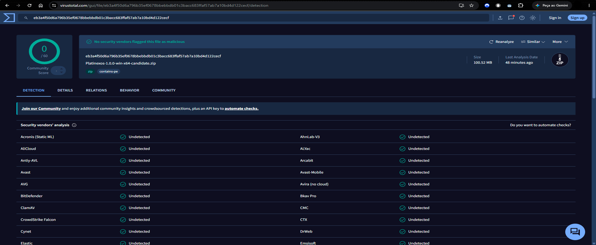
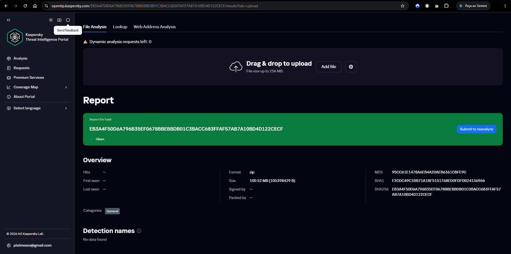
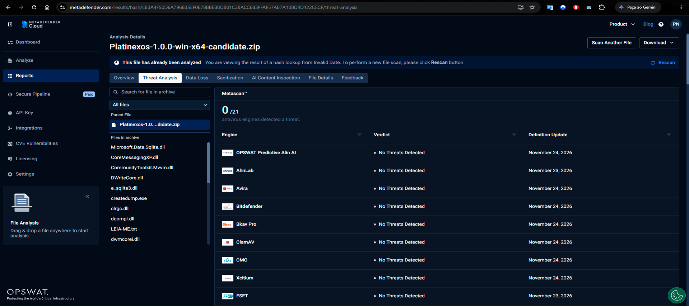

# Verificações de segurança selecionadas — PLATINEXOS 1.0.0

[English](README.md) | [Português (Brasil)](README-pt-BR.md) | [Español (Latinoamérica)](README-Espanol.md)


Data de consolidação: 25 de novembro de 2026.

Este documento apresenta três serviços selecionados para a comunicação pública do PLATINEXOS 1.0.0. **Não é um histórico integral de todos os testes, exames ou auditorias realizados.** Os registros técnicos anteriores permanecem preservados separadamente; esta revisão não os altera nem os substitui.

## Arquivo ao qual os resultados se referem

- Nome oficial: **PLATINEXOS-1.0.0-win-x64-Portable.zip**.
- Tamanho: **105.398.429 bytes**.
- Conteúdo: **575 arquivos**.
- SHA-256:

```text
EB3A4F50D6A796B35EF0678BBEBBDB01C3BACC683FFAF57AB7A10BD4D122CECF
```

Alguns relatórios apresentam o nome anterior do candidato. O SHA-256 corresponde ao arquivo oficial: a mudança de nome não modificou o conteúdo. O hash verifica a identidade do conteúdo e sua integridade, mas não substitui uma assinatura digital do editor. O executável 1.0.0 não possui assinatura digital.

## Resultados selecionados

| Serviço | Resultado documentado | Alcance |
|---|---|---|
| VirusTotal | **0/60 detecções antivírus**, reanálise de 25/11/2026 | [Consultar análise no VirusTotal](https://www.virustotal.com/gui/file/eb3a4f50d6a796b35ef0678bbebbdb01c3bacc683ffaf57ab7a10bd4d122cecf/detection) |
| Kaspersky OpenTIP | **Clean (Limpo)** para o ZIP definitivo | Classificação mostrada no painel do arquivo; não é apresentada como confirmação de análise dinâmica completa |
| OPSWAT MetaDefender Cloud | **0/21 detecções antivírus** e resultado geral **No Threats Detected** | Resultados disponíveis; alguns módulos adicionais não concluíram suas verificações |

Os resultados externos desta revisão são os registros e confirmações fornecidos pelo desenvolvedor. Não foram solicitadas novas análises, reexecutados testes ou feitas novas verificações do procedimento de consulta já validado. As observações técnicas abaixo reaproveitam as investigações concluídas do mesmo ZIP.

## VirusTotal — resultado antivírus e indicador Sigma

O resultado antivírus selecionado é **0/60**, da reanálise de 25/11/2026. Esse número descreve o painel antivírus, não todos os indicadores de comportamento. A assinatura comportamental **Potential Vcruntime140 DLL Sideloading**, nível HIGH, foi registrada nas duas análises informadas pelo desenvolvedor.

A investigação pontual do pacote encontrou:

- Nenhuma cópia de vcruntime140.dll ou variantes no ZIP.
- Nenhum componente Python ou arquivo .pyd no pacote distribuído.
- Nenhum arquivo .dmp no ZIP.
- createdump.exe legítimo do runtime .NET 10.0.13, idêntico à origem NuGet e com assinatura Microsoft válida.
- Nenhum mecanismo próprio de carregamento indevido de DLL identificado no código examinado.
- Nenhum defeito demonstrado que justificasse reconstrução do aplicativo.

A inspeção estática das importações normais e adiadas de nove componentes nativos encontrou referências ao Universal C Runtime do Windows (api-ms-win-crt-*), sem vcruntime140 nessas tabelas. Isso não demonstra todos os carregamentos transitivos que possam ocorrer no sistema operacional do ambiente analisado.

**A origem exata da assinatura Sigma permaneceu inconclusiva.** Na investigação, os dados comportamentais detalhados ficaram bloqueados por HTTP 429/RecaptchaRequiredError. Não foi possível identificar o processo que acionou a regra, o caminho/hash da DLL observada, o autor do dump ou a origem dos componentes Python mencionados no ambiente. A proteção de acesso não foi contornada.

A ausência da DLL no conteúdo distribuído afasta a hipótese específica de uma cópia substituída entregue no ZIP, mas não resolve sozinha o evento ocorrido no sandbox. Não se classifica a assinatura como falso positivo comprovado. Sua severidade HIGH e o resultado antivírus 0/60 são informações distintas, preservadas neste documento.

Como referência técnica da regra pública correspondente: [SigmaHQ — Potential Vcruntime140 DLL Sideloading](https://github.com/SigmaHQ/sigma/blob/master/rules/windows/image_load/image_load_side_load_vcruntime140.yml). Não foi confirmada a revisão exata empregada pelo VirusTotal.

### Consulta do relatório VirusTotal

[Consultar análise no VirusTotal](https://www.virustotal.com/gui/file/eb3a4f50d6a796b35ef0678bbebbdb01c3bacc683ffaf57ab7a10bd4d122cecf/detection). Link direto confirmado pelo desenvolvedor em janela anônima. Não é necessário novo envio. Nomes de candidatos anteriores correspondem ao mesmo SHA-256.

## Kaspersky OpenTIP

O ZIP definitivo foi classificado como **Clean**. A captura descrita pelo desenvolvedor identifica o arquivo, seu SHA-256, tamanho de 105.398.429 bytes e formato ZIP.

[Consultar o relatório do ZIP no Kaspersky OpenTIP](https://opentip.kaspersky.com/EB3A4F50D6A796B35EF0678BBEBBDB01C3BACC683FFAF57AB7A10BD4D122CECF/results?tab=upload).

Esta apresentação refere-se ao ZIP. Não se atribui ao painel a conclusão de uma análise dinâmica completa que não esteja demonstrada pelo resultado específico documentado.

## OPSWAT MetaDefender Cloud

Os registros fornecidos apresentam:

- Resultado geral: **No Threats Detected**.
- MetaScan: **Not Detected**.
- Threat Analysis: **0/21**.
- File Details: **Allowed**.
- Reason: **No Threat Detected**.

[Consultar o relatório do ZIP no MetaDefender Cloud](https://metadefender.com/results/hash/EB3A4F50D6A796B35EF0678BBEBBDB01C3BACC683FFAF57AB7A10BD4D122CECF/overview).

O desenvolvedor confirmou o endereço em janela anônima. Alguns módulos adicionais não concluíram as verificações. Assim, não se declara conclusão de todos os módulos, e os resultados antivírus não são confundidos com os indicadores DLP.

### Apontamentos DLP investigados

Foram examinados integralmente MANIFESTO.json, DEPENDENCIAS.json e AVISOS-LEGAIS.txt. Não foram encontradas credenciais privadas ou dados pessoais privados nesses três arquivos.

| Arquivo | Evidência e limite da investigação |
|---|---|
| MANIFESTO.json | Oito posições fornecidas foram localizadas: cinco em hashes SHA-256 e três em versões de caminhos de componentes. Os oito casos são falsos positivos comprovados pelo contexto e pela origem dos valores. Os 574 hashes conferem com os arquivos reais. Oito outros apontamentos não tinham localização suficiente para associação individual. |
| DEPENDENCIAS.json | Os 22 registros contêm nome, versão e URL pública NuGet. Foram identificadas 14 sequências de nove dígitos em versões e URLs públicas; sem offsets do provedor, a associação individual aos 14 alertas permanece inconclusiva. |
| AVISOS-LEGAIS.txt | Três sequências de nove dígitos correspondem a versões de componentes ou URL pública. A associação individual aos três alertas depende de suas localizações originais. |

Os 25 apontamentos sem correspondência individual confirmada não foram tratados como 25 dados privados encontrados. A investigação não identificou necessidade de remover hashes, editar versões ou reconstruir o ZIP para tratar essas sinalizações.

## Uso seguro da integração Steam

O PLATINEXOS é gratuito e independente, sem afiliação, patrocínio ou aprovação da Valve Corporation. Não solicita senhas Steam ou códigos Steam Guard. A integração usa uma chave pessoal Steam Web API, com armazenamento opcional no Gerenciador de Credenciais do Windows. Salvar a chave e autorizar sincronização automática são decisões separadas por conta.

Não compartilhe a chave em Issues, capturas ou relatórios. Consulte os [Termos de Uso](TERMOS-DE-USO.md) e a [Política de Privacidade](POLITICA-DE-PRIVACIDADE.md) para as condições e instruções de armazenamento, revogação e exclusão. Este documento explicativo não altera esses textos jurídicos.

## Conclusão e limites documentados

Os resultados apresentados são **0/60 no painel antivírus do VirusTotal**, **Clean no Kaspersky OpenTIP** e **0/21 com No Threats Detected no MetaDefender**. As inspeções técnicas realizadas não demonstraram comportamento malicioso ou defeito que justificasse alterar o PLATINEXOS 1.0.0 aprovado.

Permanecem delimitados: módulos adicionais do MetaDefender sem conclusão, associação individual incompleta de parte dos sinais DLP e origem não determinada da assinatura Sigma. Não se convertem essas limitações em defeitos não demonstrados, nem se apresenta a contagem antivírus como certificação absoluta do arquivo ou de cada componente. Nenhum aplicativo ou pacote foi modificado para mudar os resultados.


## Capturas dos resultados selecionados



*VirusTotal: 0 detecções em 60 mecanismos antivírus*



*Kaspersky OpenTIP: Clean (Limpo)*



*OPSWAT MetaDefender: 0 detecções em 21 mecanismos antivírus*

Evidências originais complementares (incluindo uma tela histórica de detecção anterior):

- [01-virustotal-file-details.png](Imagens-Release-v3/02-Security-Reports/Additional/01-virustotal-file-details.png)
- [02-metadefender-overview.png](Imagens-Release-v3/02-Security-Reports/Additional/02-metadefender-overview.png)
- [03-metadefender-file-details.png](Imagens-Release-v3/02-Security-Reports/Additional/03-metadefender-file-details.png)
- [04-virustotal-detection-previous.png](Imagens-Release-v3/02-Security-Reports/Additional/04-virustotal-detection-previous.png)
